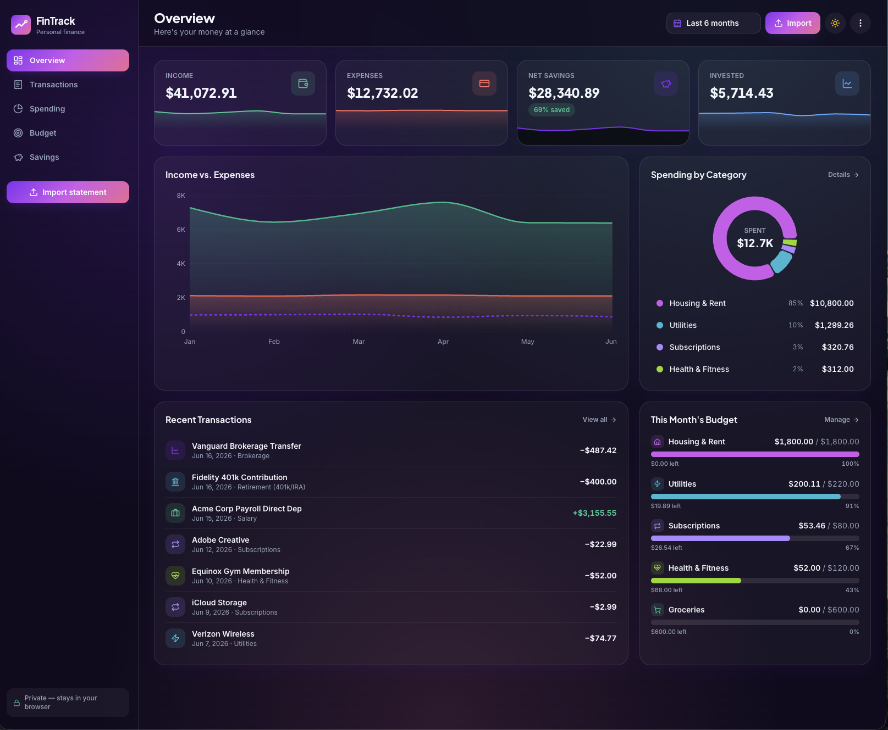

# FinTrack — Personal Finance Tracker Dashboard

A polished, self-hosted personal finance dashboard. Import your bank statements as PDFs and
track income, expenses, investments, saving patterns and budgets. Statements are parsed in your
browser; your data is saved to a small SQLite database on your own server (e.g. a Raspberry Pi).

Built with **React 18 + TypeScript + Vite**, Tailwind CSS, Recharts, Zustand and pdf.js.

> **Privacy:** statements are parsed in-browser with pdf.js; nothing is sent anywhere except your own
> FinTrack server. Transactions, categories and budgets live in its SQLite database, so clearing your
> browser data doesn't lose anything. Theme and date range are remembered per device (`localStorage`).
> The API has no login — keep it on your home network and don't port-forward it to the internet.

## Features

- **Overview** — animated KPI cards (income, expenses, net savings, savings rate, invested), an
  income-vs-expenses trend chart, category-spending donut, this month's budget, and recent activity.
- **Transactions** — searchable, sortable, filterable table with **inline category/type editing**,
  bulk recategorize, and full add/edit/delete.
- **Spending** — category breakdown, top merchants, month-over-month bars, and **click-to-drill-down**
  into the transactions behind any category.
- **Budget** — set a monthly limit per category, track progress with over-budget alerts, and see a
  **50 / 30 / 20** needs/wants/savings allocation vs. targets.
- **Savings & Investments** — savings-rate trend, cumulative savings curve, and investment allocation.
- **PDF import** — drag-and-drop a statement; transactions are auto-detected and categorized, then you
  **review and correct every row** before importing.
- Bold, colorful UI with a **light/dark toggle**, smooth animations, and a responsive mobile layout.
- **Seeded sample data** on first run so every chart is alive immediately — clear it anytime from the
  top-right menu.



## Getting started

```bash
npm install
npm run server       # data API on :3001 (SQLite file in ./data)
npm run dev          # http://localhost:5173 (proxies /api to the server)
```

### Scripts

| Script              | Purpose                                                                           |
| ------------------- | --------------------------------------------------------------------------------- |
| `npm run dev`       | Start the Vite dev server                                                         |
| `npm run server`    | Start the data API (`server/index.ts`, SQLite in `./data`)                        |
| `npm run build`     | Type-check and build for production (`dist/`)                                     |
| `npm run preview`   | Preview the production build                                                      |
| `npm run typecheck` | Type-check the app and the server                                                 |
| `npm run lint`      | ESLint (zero warnings allowed)                                                    |
| `npm test`          | PDF import, sample data, API server and storage tests                             |

## Self-hosting with Docker

Two containers, both built from this repo — you don't need Node installed on the host
(works on a Raspberry Pi, 64-bit OS):

- `fintrack` — nginx serving the static app and proxying `/api/` to the API
- `api` — the data server (Node + built-in SQLite), database in the `fintrack-data` volume

```bash
docker compose up -d --build     # → http://localhost:8080 (or http://<pi-address>:8080)
```

Change the host port by editing the `8080:80` mapping in `docker-compose.yml`;
stop with `docker compose down`. Rebuilding or restarting keeps your data — only
`docker compose down -v` deletes the volume.

nginx is configured for client-side-routing fallback (deep links like `/budget` work on
refresh) and serves pdf.js's `.mjs` worker with a valid JS MIME type. If the API is down,
the app shows a "can't reach the server" screen instead of loading (so it can't overwrite
your data with sample data).

### Backup and restore

The whole database is one file. Run these from the project directory:

```bash
# Backup (do it while nobody is editing)
docker compose cp api:/data/fintrack.db ./fintrack-$(date +%F).db

# Restore
docker compose cp ./fintrack-2026-11-14.db api:/data/fintrack.db
docker compose exec -u root api chown node:node /data/fintrack.db   # copied files are owned by your user; the API needs to write it
docker compose restart api
```

> Hosting under a sub-path (e.g. `/fintrack/`) rather than the server root? Set
> `base: '/fintrack/'` in `vite.config.ts` and rebuild.

## Importing bank statements (read this)

PDF statements vary enormously between banks, so import is **heuristic + human-in-the-loop**:

1. Text is extracted with pdf.js and reconstructed into lines.
2. Lines that start with a date and contain an amount are treated as transactions; the description is
   auto-categorized by keyword rules.
3. **You review every parsed row** — low-confidence rows are highlighted — and can fix the date,
   description, amount, category, or deselect junk rows before importing.

Limitations:

- **Scanned / image-only PDFs** (no text layer) cannot be read automatically. The app detects this and
  prompts you to **add transactions manually** instead.
- Sign detection prefers explicit cues (parentheses/minus); otherwise it's inferred from the category.
  Always glance at the review table before importing.

## Project structure

```
src/
  types/              Domain model (Transaction, Category, …)
  lib/
    analytics.ts      Pure metrics: totals, trends, by-category, budget, merchants
    categorize.ts     Keyword → category/type rules
    statementParser.ts Pure statement-text → transactions (unit-tested)
    pdfImport.ts      pdf.js text extraction (delegates parsing to statementParser)
    sampleData.ts     ~6 months of realistic demo transactions
    categories.ts     Seed categories (colors, icons, default budgets)
    format.ts         Currency / percent / date formatters
    storage.ts        Persist storage: data → server API, theme/date range → localStorage
  store/useStore.ts   Zustand store + persistence + seeding
  hooks/              useFiltered (date-range selector), useImport (modal control)
  components/         layout · ui · charts · transactions · dashboard · import
  pages/              Overview · Transactions · Spending · Budget · Savings
server/index.ts       Data API: GET/PUT /api/state backed by SQLite (node:sqlite)
scripts/              Tests (import, sample data, server, storage)
```

## Tech stack

React 18 · TypeScript · Vite · Tailwind CSS · Recharts · Zustand · pdf.js (`pdfjs-dist`) ·
framer-motion · date-fns · lucide-react · Node (`node:http` + `node:sqlite`) · nginx.
